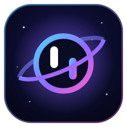
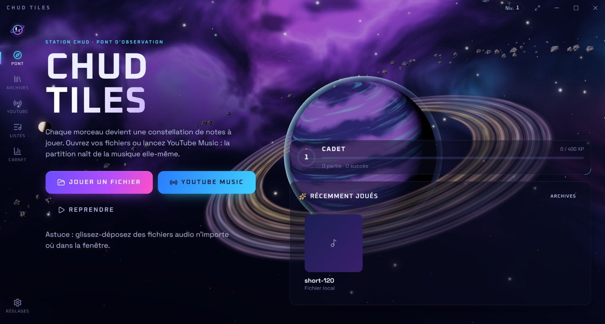
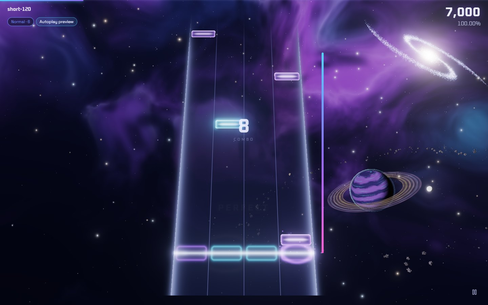
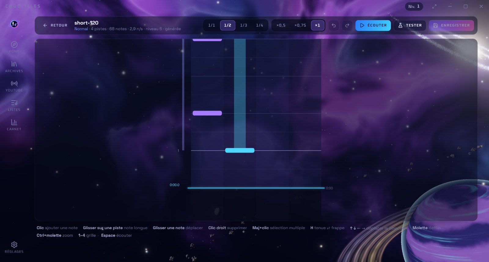
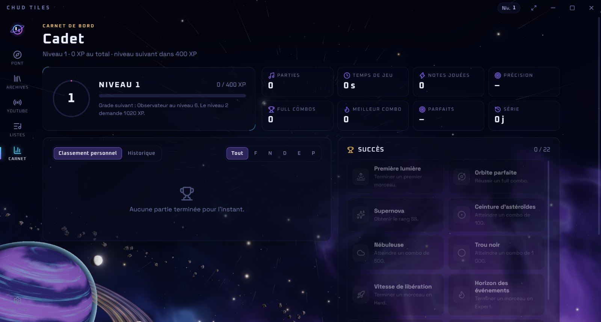

<p align="center">
  
</p>

<h1 align="center">Chud Tiles</h1>

<p align="center">
  <b>Un jeu de rythme qui écrit ses partitions à partir de votre musique.</b><br>
  Fichiers locaux ou YouTube Music · Windows · Linux · navigateur
</p>

<p align="center">
  <a href="https://github.com/BigFatDeuce/Chud-Tiles/actions/workflows/ci.yml"></a>
  &nbsp;·&nbsp; <a href="README.md">English version</a>
</p>



Les notes glissent sur des pistes lumineuses vers une ligne de frappe : appuyez sur la piste quand elles la touchent. Personne n'écrit les partitions à la main. Chud Tiles écoute chaque morceau (tempo, temps, grosse caisse, caisse claire, cymbales, sons tenus, refrains) et en tire une partition jouable pour chaque difficulté.

## Ce qu'il sait faire

**Des partitions nées de la musique**
- Tempo, temps et mesures ; grosse caisse, caisse claire et cymbales réparties sur les pistes ; notes longues sur les sons tenus ; accords et rafales ; plus de notes dans les refrains.
- Facile, Normal, Difficile, Expert et Personnalisé (densité, subdivisions, accords, notes longues, écart minimal, fenêtres de jugement), chacune notée de 1 à 20, sur 3 à 7 pistes.
- Un même morceau donne toujours la même partition, et chaque analyse est gardée en cache.

**Votre musique, intacte**
- Fichiers locaux : MP3, FLAC, WAV, OGG, OPUS, AAC, M4A, AIFF, WMA, ALAC. Glisser-déposer, dossiers surveillés, favoris. Les fichiers ne sont jamais copiés ni modifiés.
- YouTube Music par **le lecteur officiel de YouTube** : recherche, albums, playlists, radio. Rien n'est téléchargé et aucun flux audio n'est extrait ; seules des mesures rythmiques sortent du lecteur.
  - *Jouer en direct* : les notes sont prédites un peu en avance pendant que le morceau joue.
  - *Écouter d'abord* : une écoute complète, puis la partition entière.
  - Un morceau joué en direct jusqu'au bout est *appris* : la partie suivante a la partition complète.
- Pensé pour cohabiter avec [Chud Music](https://github.com/BigFatDeuce/Chud-Music) : le même bloqueur de publicités (moteur Ghostery, listes uBlock Origin, appliqué au seul lecteur) et la bibliothèque et les listes de Chud Music, en lecture seule.

**Jouez comme vous voulez**
- Clavier, souris, tactile et manette ; chaque touche se change, une disposition par nombre de pistes.
- Calibration du son et de l'image, décalage propre à YouTube, et courbe de précision après chaque partie avec une correction proposée.
- Entraînement (vitesse de 50 à 100 %, une section, en boucle), aperçu automatique, et un atelier pour retoucher n'importe quelle partition générée.
- Progression : XP, 8 grades d'équipage, 22 succès, classement personnel par difficulté, historique complet.

**Un univers vivant**
- Scènes spatiales procédurales dessinées avec Three.js (WebGL2) : nébuleuses, planètes à anneaux, ceintures d'astéroïdes.
- Les images par seconde suivent l'écran (60, 120, 144, 240 Hz…) ; les frappes sont jugées sur leur propre horodatage, quelle que soit la cadence.
- Mode sans échec (rendu logiciel, effets minimaux) pour les pilotes graphiques capricieux ; il s'active seul après des plantages répétés.
- Interface en français et en anglais.

## Captures

| | |
|---|---|
|  |  |
|  |  |

## Plateformes

| Plateforme | Paquet | Remarques |
|---|---|---|
| Windows 10/11 | `Chud-Tiles-Setup-<version>.exe`, `Chud-Tiles-<version>-Portable.exe` | installeur en français ou en anglais, ou exécutable portable. Non signé : SmartScreen demande une fois (*Informations complémentaires › Exécuter quand même*). |
| Linux x64 | `.AppImage`, `.tar.gz`, `.deb`, `.rpm` | AppImage : `chmod +x`, puis lancez-la. |
| Navigateur | site statique (`npm run web:build`) servi en HTTPS | Chrome ou Edge recommandés. Fichiers locaux, et YouTube à partir d'un lien collé (partage du son de l'onglet). |
| macOS | `npm run dist:mac` sur un Mac | configuration prête, pas encore construite ni testée. |

Votre profil, vos records et vos analyses restent sur votre ordinateur (`%APPDATA%\Chud Tiles` sous Windows, `~/.config/Chud Tiles` sous Linux, le stockage du navigateur sur le web).

## Commandes par défaut

| Action | Clavier | Manette | Souris / tactile |
|---|---|---|---|
| Pistes (4 pistes) | `D` `F` `J` `K` ou les flèches | croix, boutons, gâchettes | touchez la piste |
| Pause | `Échap` | Start | bouton pause |
| Recommencer | `²` | — | menu pause |

Jugements : Parfait ±45 ms, Super ±90 ms, Bien ±135 ms. Les règles complètes, les autres nombres de pistes et le dépannage sont dans le [guide du joueur](docs/GUIDE-UTILISATEUR.md).

## Construire depuis les sources

Node 24 ou plus récent.

```sh
npm install
npm run dev        # application de bureau (Electron)
npm run web:dev    # version navigateur
```

| Commande | Effet |
|---|---|
| `npm run typecheck` | vérification TypeScript (main, preload, interface) |
| `npm run test:unit` | analyse, génération, prédiction en direct, jugement, progression, traductions (Node, sans application) |
| `npm run test:e2e` | l'application réelle pilotée par Playwright, muette et invisible (`-- --online` ajoute YouTube) |
| `npm run test:web` | la version navigateur, hors ligne |
| `npm run test:i18n` | textes de l'interface sans traduction anglaise |
| `npm run dist:win` | installeur et exécutable portable Windows dans `dist/` |
| `npm run dist:linux` | AppImage, .tar.gz, .deb, .rpm (sous Linux ; depuis Windows, `scripts/linux-dist.sh` dans WSL) |
| `npm run dist:mac` | .dmg et .zip (sur un Mac) |
| `npm run web:build` | site statique dans `dist-web/` |

**FFmpeg (facultatif).** Les formats rares (WMA, ALAC, certains AIFF) sont décodés par FFmpeg. Les paquets de bureau embarquent la version LGPL, audio seulement, de Chud Music : `scripts/prepare-dist.mjs` la copie depuis une copie de Chud Music qui contient son dossier `build/vendor` (variable `CHUD_MUSIC_DIR`, ou chemin écrit dans un fichier local `.chud-music-dir`). Sans elle, les paquets sont construits sans FFmpeg et les autres formats fonctionnent.

## Documentation

| | Français | English |
|---|---|---|
| Guide du joueur | [docs/GUIDE-UTILISATEUR.md](docs/GUIDE-UTILISATEUR.md) | [docs/USER-GUIDE.md](docs/USER-GUIDE.md) |
| Documentation technique | [docs/DOC-TECHNIQUE.md](docs/DOC-TECHNIQUE.md) | — |
| Étude préalable et choix | [docs/ETUDE-ARCHITECTURE.md](docs/ETUDE-ARCHITECTURE.md) | — |
| Bilan : ce qui marche, limites | [docs/BILAN.md](docs/BILAN.md) | — |

## Construit avec

Electron, React, TypeScript, Three.js, Zustand, Vite et electron-vite, [youtubei.js](https://github.com/LuanRT/YouTube.js), [le bloqueur de Ghostery](https://github.com/ghostery/adblocker), FFmpeg (LGPL), les polices Oxanium et Space Grotesk (SIL OFL) et les icônes Lucide. L'empaquetage écrit la liste complète des licences tierces dans `THIRD-PARTY-NOTICES.txt`, livré avec l'application.

## À savoir

- Chud Tiles n'est affilié ni à YouTube ni à Google. Les vidéos YouTube sont lues par le lecteur intégré officiel de YouTube et restent soumises à ses conditions. Le bloqueur de publicités, facultatif, peut aller à l'encontre de ces conditions ; il se coupe dans Réglages › YouTube.
- Aucune licence n'a encore été choisie : le code est public en lecture, mais tous droits réservés.
