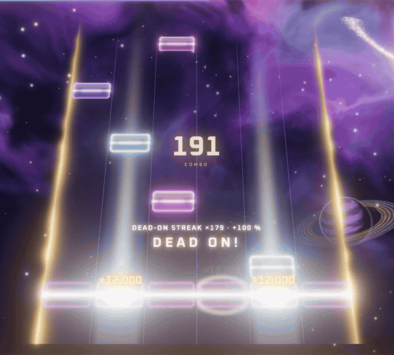
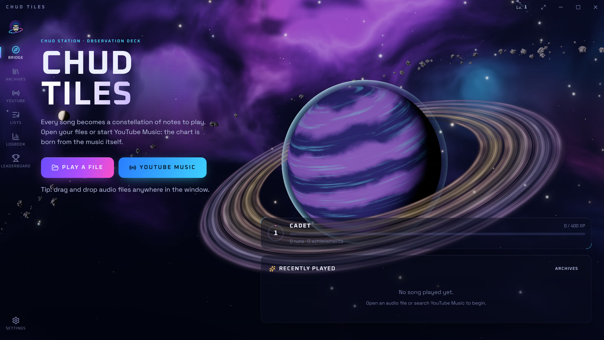
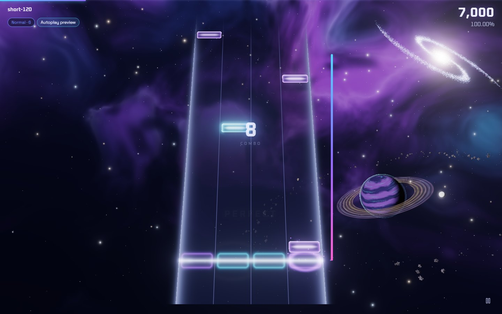
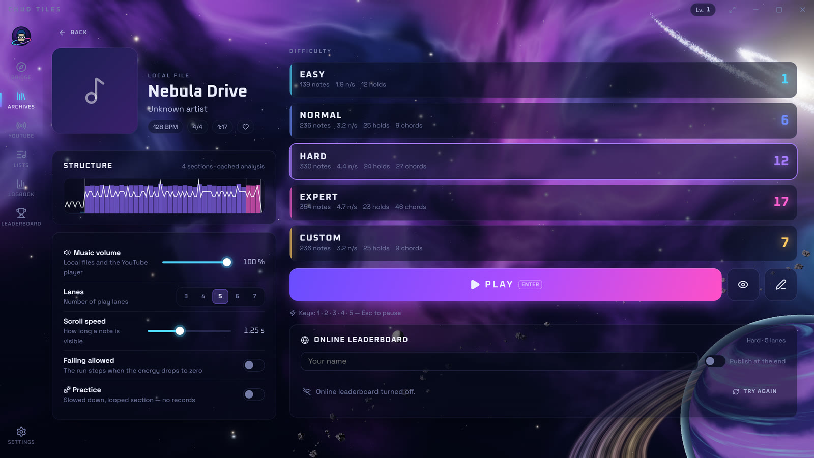
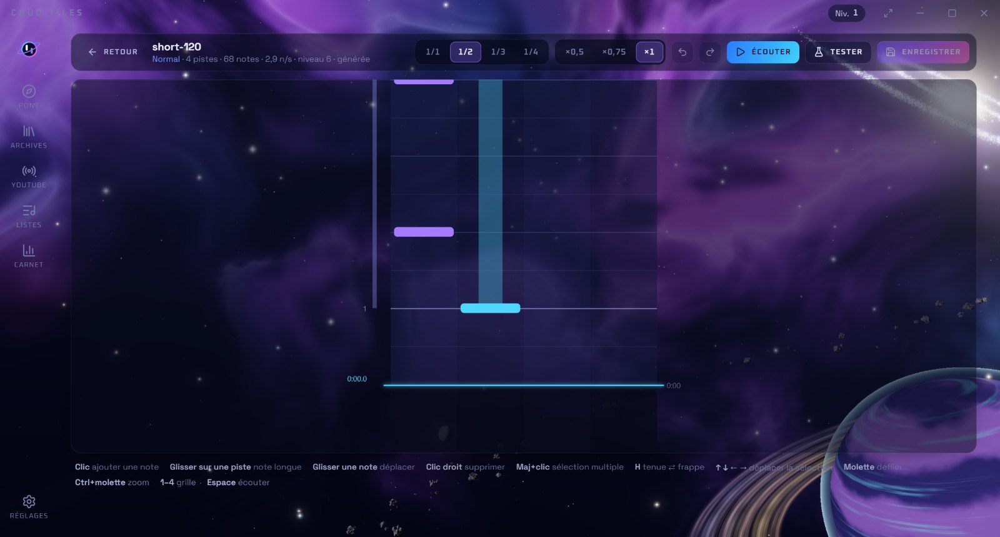
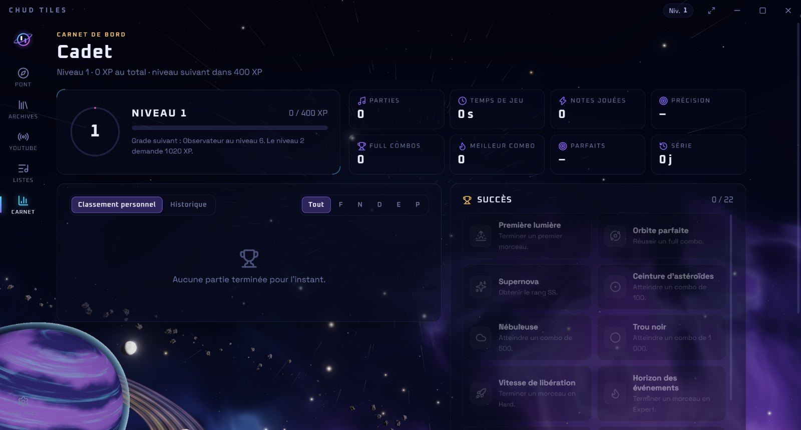

<p align="center">
  
</p>

<h1 align="center">Chud Tiles</h1>

<p align="center">
  <b>A rhythm game that writes its charts from your music.</b><br>
  Local files or YouTube Music · Windows · Linux · browser
  <br><b><a href="https://chud-tiles.holy-c.men">Play in your browser: chud-tiles.holy-c.men</a></b>
</p>

<p align="center">
  <a href="https://github.com/BigFatDeuce/Chud-Tiles/releases/latest"></a>
  <a href="https://github.com/BigFatDeuce/Chud-Tiles/releases/latest"></a>
  <a href="https://github.com/BigFatDeuce/Chud-Tiles/actions/workflows/ci.yml"></a>
  &nbsp;·&nbsp; <a href="README.fr.md">Version française</a>
</p>

<p align="center">
  
</p>

<p align="center">
  <a href="https://github.com/BigFatDeuce/Chud-Tiles/releases/latest"><b>⬇ Download for Windows or Linux</b></a> &nbsp;·&nbsp;
  <a href="https://chud-tiles.holy-c.men"><b>▶ Play in your browser</b></a>
</p>



Notes slide down glowing lanes toward a hit line: press the lane when they touch it. Nobody charts the songs by hand. Chud Tiles listens to each song (tempo, beats, kick, snare, cymbals, sustained sounds, choruses) and builds a playable chart for every difficulty.

## Features

**Charts born from the music**
- Tempo, beats and bars; kick, snare and cymbals spread across the lanes; holds on sustained sounds; chords and streams; denser charts in the choruses.
- Easy, Normal, Hard, Expert and Custom (density, subdivisions, chords, holds, minimum gap, judgement windows), each rated from 1 to 20, on 3 to 7 lanes.
- The same song always gives the same chart, and each analysis is cached.

**Your music, untouched**
- Local files: MP3, FLAC, WAV, OGG, OPUS, AAC, M4A, AIFF, WMA, ALAC. Drag and drop, watched folders, favourites. Files are never copied or modified.
- YouTube Music: search, albums, playlists, radio. The desktop app downloads the song's sound once with [yt-dlp](https://github.com/yt-dlp/yt-dlp) (installed on first use) and plays it like a local file: full chart at once, no ads, no stutter. The other way is **YouTube's official player**, with nothing downloaded (also the fallback when a download fails):
  - *Play live*: notes are predicted a moment ahead while the song plays.
  - *Listen first*: one full listen, then the complete chart.
  - A song played live to the end is *learned*: the next run gets the full chart.
- **Shared charts**: a YouTube song learned or downloaded by one player is ready, with its full chart, for everyone else, browser version included. Only the rhythm analysis is shared (beats, attacks, sections), never the audio.
- Built to sit next to [Chud Music](https://github.com/BigFatDeuce/Chud-Music): the same ad blocker (Ghostery engine, uBlock Origin lists, applied to the player only) and Chud Music's library and playlists, read only.

**Scoring**
- Each tile has a narrow centre band: a note hit dead on (±20 ms) is worth half as much again, and a streak of dead-on hits adds up to +100 %.
- A combo multiplier from ×2 at 25 notes to ×8 at 400; each tier sets the lanes on fire, with shock waves, beams and a flash when the combo breaks.
- Ranks from D to SS, full combos, and a timing curve after each run with a suggested correction.

**Play your way**
- Keyboard, mouse, touch and gamepad; every binding can be changed, one layout per lane count.
- Audio and display calibration, a separate offset for YouTube, music volume before the run and in the pause menu.
- Practice mode (50 to 100 % speed, one section, looped), autoplay preview, and a chart workshop to touch up any generated chart.
- Progression: XP, 8 crew ranks, 22 achievements, a personal leaderboard per difficulty, full history.

**Online leaderboard**
- After a finished song (Easy to Expert), pick a name and publish your score on [chud-tiles.holy-c.men](https://chud-tiles.holy-c.men). Each song has its board per difficulty and lane count, and the *Leaderboard* tab lists the 100 latest scores.
- Nothing is sent unless you publish (a name and the score). The leaderboard and shared charts can be switched off in Settings › Game.

**A living universe**
- Procedural space scenes drawn with Three.js (WebGL2): nebulae, ringed planets, asteroid belts.
- The frame rate follows the screen (60, 120, 144, 240 Hz…); taps are judged on their own timestamps, whatever the frame rate.
- Safe mode (software rendering, minimal effects) for difficult graphics drivers; it turns itself on after repeated crashes.
- Interface in English and French. The Windows installer and the AppImage update themselves.

## Screenshots

| | |
|---|---|
|  |  |
|  |  |

## Platforms

| Platform | Package | Notes |
|---|---|---|
| Windows 10/11 | `Chud-Tiles-Setup-<version>.exe`, `Chud-Tiles-<version>-Portable.exe` | installer in English or French, or a portable exe. Unsigned: SmartScreen asks once (*More info › Run anyway*). |
| Linux x64 | `.AppImage`, `.tar.gz`, `.deb`, `.rpm` | AppImage: `chmod +x`, then run it. |
| Browser | [chud-tiles.holy-c.men](https://chud-tiles.holy-c.men), or your own static site (`npm run web:build`) served over HTTPS | Chrome or Edge recommended. Local files, and YouTube from a pasted link: a song someone already learned or downloaded comes with its full chart (shared charts), otherwise tab audio sharing. |
| macOS | `npm run dist:mac` on a Mac | configuration ready, not built or tested yet. |

Your profile, records and analyses stay on your computer (`%APPDATA%\Chud Tiles` on Windows, `~/.config/Chud Tiles` on Linux, the browser's storage on the web).

## Default controls

| Action | Keyboard | Gamepad | Mouse / touch |
|---|---|---|---|
| Lanes (4 lanes) | `1` `2` `3` `4` (number row) or arrows | D-pad, face buttons, shoulders | tap the lane |
| Pause | `Esc` | Start | pause button |
| Restart | `Backspace` | — | pause menu |

Judgements: Dead on ±20 ms (hit the tile's centre line: worth half as much again, and a streak bonus), Perfect ±45 ms, Great ±90 ms, Good ±135 ms. Full rules, other lane counts and troubleshooting are in the [player guide](docs/USER-GUIDE.md).

## Building from source

Node 24 or newer.

```sh
npm install
npm run dev        # desktop app (Electron)
npm run web:dev    # browser version
```

| Command | Does |
|---|---|
| `npm run typecheck` | TypeScript check (main, preload, interface) |
| `npm run test:unit` | analysis, chart generation, live prediction, judgement, progression, translations (Node, no app) |
| `npm run test:e2e` | the real app driven by Playwright, muted and invisible (`-- --online` adds YouTube) |
| `npm run test:web` | the browser version, offline |
| `npm run test:i18n` | interface texts missing an English translation |
| `npm run dist:win` | Windows installer and portable exe in `dist/` |
| `npm run dist:linux` | AppImage, .tar.gz, .deb, .rpm (on Linux; from Windows, run `scripts/linux-dist.sh` in WSL) |
| `npm run dist:mac` | .dmg and .zip (on a Mac) |
| `npm run web:build` | static site in `dist-web/` |
| `npm run site:deploy` | builds the site and deploys it with the leaderboard API to Cloudflare (`server/`: Worker + D1; needs `wrangler login`) |

**FFmpeg (optional).** Rare formats (WMA, ALAC, some AIFF) are decoded by FFmpeg. The desktop packages ship Chud Music's LGPL, audio-only FFmpeg build: `scripts/prepare-dist.mjs` copies it from a Chud Music checkout that has its `build/vendor` folder (set `CHUD_MUSIC_DIR`, or write the path in a local `.chud-music-dir` file). Without it, packages are built without FFmpeg and the other formats still work.

## Documentation

| | English | Français |
|---|---|---|
| Player guide | [docs/USER-GUIDE.md](docs/USER-GUIDE.md) | [docs/GUIDE-UTILISATEUR.md](docs/GUIDE-UTILISATEUR.md) |
| Technical documentation | — | [docs/DOC-TECHNIQUE.md](docs/DOC-TECHNIQUE.md) |
| Architecture study | — | [docs/ETUDE-ARCHITECTURE.md](docs/ETUDE-ARCHITECTURE.md) |
| Status: what works, known limits | — | [docs/BILAN.md](docs/BILAN.md) |

## Built with

Electron, React, TypeScript, Three.js, Zustand, Vite and electron-vite, [youtubei.js](https://github.com/LuanRT/YouTube.js), [Ghostery's ad blocker](https://github.com/ghostery/adblocker), FFmpeg (LGPL), the Oxanium and Space Grotesk fonts (SIL OFL) and Lucide icons. Packaging writes the full list of third-party licences to `THIRD-PARTY-NOTICES.txt`, shipped with the app.

## Notes

- Chud Tiles is not affiliated with YouTube or Google. YouTube videos are played by YouTube's official embedded player and remain subject to YouTube's terms. Downloading songs with yt-dlp (the default on the desktop) and the ad blocker go against those terms: both are for personal use, at your own risk, and can be switched off in Settings › YouTube.
- No licence has been chosen yet: the code is public to read, but all rights are reserved.
